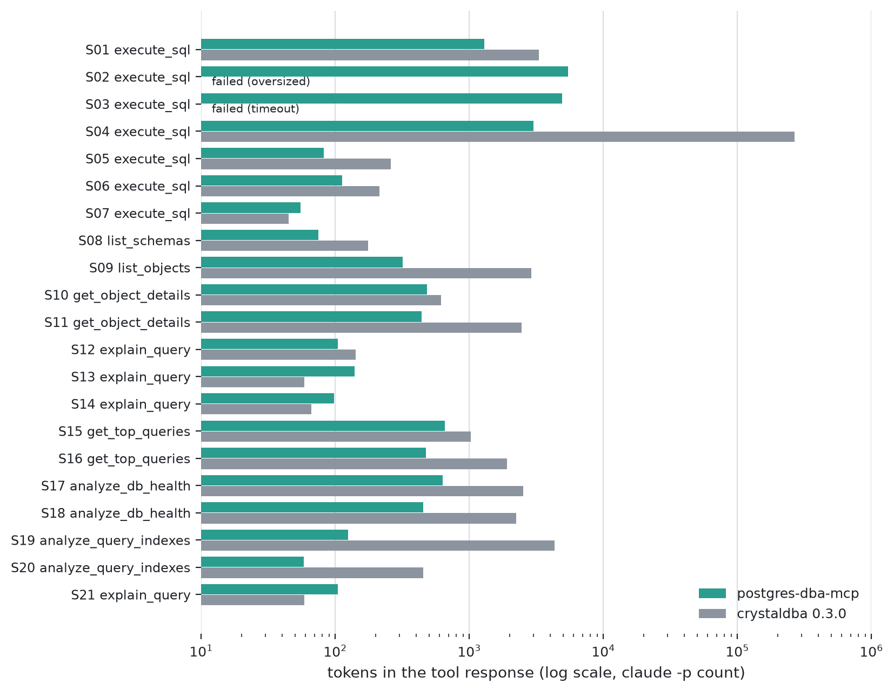
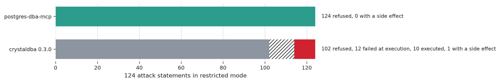
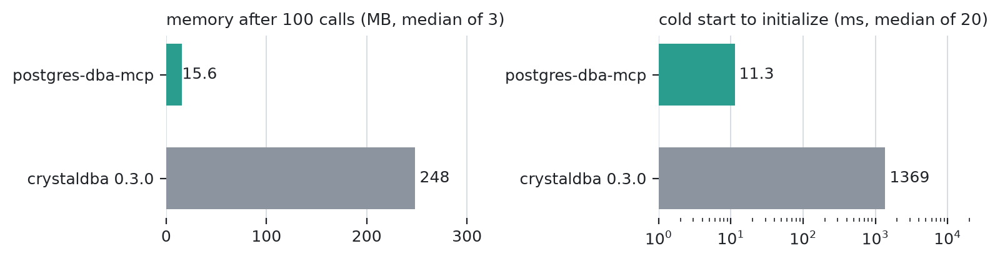

# Benchmark

postgres-dba-mcp against [crystaldba/postgres-mcp](https://github.com/crystaldba/postgres-mcp) 0.3.0, the latest release (May 2025). Measured on 2026-10-22. The harness lives in the development repository and is not part of this release; this page gives the method and every number it produced, including the ones that do not favour postgres-dba-mcp. Its inputs are published: the data set in [bench/data](bench/data), the 131 attacks and 47 legitimate statements in [testdata/safesql](testdata/safesql), and the scenarios and tasks in the tables below.

## At a glance

<picture>
  <source media="(prefers-color-scheme: dark)" srcset="assets/bench/tokens-dark.png">
  
</picture>

<picture>
  <source media="(prefers-color-scheme: dark)" srcset="assets/bench/security-dark.png">
  
</picture>

<picture>
  <source media="(prefers-color-scheme: dark)" srcset="assets/bench/ops-dark.png">
  
</picture>

## Setup

| | |
|---|---|
| Database | PostgreSQL 17.11 in Docker; `events` 5,000,000 rows, `orders` 1,000,000, `accounts` 50,000, plus [Pagila](https://github.com/devrimgunduz/pagila) and a `traps` schema (below); `ANALYZE`, then 120 s of pgbench to fill `pg_stat_statements` |
| crystaldba | Docker image `crystaldba/postgres-mcp` pinned by digest `sha256:dbbd346860d29f1543e991f30f3284bf4ab5f096d049ecc3426528f20b1b6e6b` (`postgres_mcp` 0.3.0), `--access-mode=restricted` |
| postgres-dba-mcp | built from source, `--access-mode=restricted`, default limits (`--max-bytes` 32768) |
| Role | both servers connect as the same read-only role `bench_ro` |
| Tokens | counted by Claude Code (`claude -p`, Claude Opus 5.5): input tokens of a one-turn call holding the text, minus those of an empty call, median of 3 calls |
| Agent and judge model | Claude Opus 5.5 through `claude -p`, default effort |

Commits: the deterministic scenarios ran on `c933662`; security, operations, the agent tasks and the judge on `f0d7f20`; T13 was run again on `daf8c3a` (see [Answer quality](#answer-quality-llm-judge)). Between `c933662` and `f0d7f20` only the `analyze_db_health` buffer line changed (it now names the tables behind a low cache hit rate), which no scenario in the token median uses.

## Data

Generated with a fixed random seed, then `ANALYZE`.

| Table | Rows | Columns | Why it is there |
|---|---|---|---|
| `public.accounts` | 50,000 | `id int`, `name text`, `created_at timestamptz` | joins, primary-key lookups |
| `public.events` | 5,000,000 | `id bigserial`, `account_id int`, `kind text` (4 values), `created_at timestamptz`, `payload jsonb` (small object) | large table; no index on `(account_id, created_at)` on purpose, for the plan and index-advice tasks |
| `public.orders` | 1,000,000 | `id bigserial`, `account_id int`, `status text` (`done` 95 %, `pending` and `failed` 2.5 % each), `amount numeric(10,2)`, `created_at timestamptz` | low-selectivity filter, date ranges |
| `public.docs` | 100 | `id int`, `body text` (50 kB), `payload jsonb` (20 kB) | oversized cells |
| `public.wide60` | 10 | 60 `int` columns | wide rows and object details |
| `public.types` | 2 | `text`, an empty `text`, `numeric`, `int[]`, `interval`, `timestamptz`, `bytea`; the second row all `NULL` | value rendering, NULL against empty string |
| Pagila | about 16,000 rentals and payments | the sample DVD-rental schema: films, customers, rentals, payments, categories, foreign keys, views | realistic joins and schema questions; [devrimgunduz/pagila](https://github.com/devrimgunduz/pagila) at a pinned commit, checked by SHA-256 |

The `traps` schema holds six problems a health check should find:

| Trap | Object |
|---|---|
| T1 invalid index | a unique index built `CONCURRENTLY` on duplicate values (`traps.inval`) |
| T2 duplicate indexes | `(account_id)` covered by `(account_id, created_at)` (`traps.dup_events`) |
| T3 dead tuples | `traps.bloated`, 200,000 rows with 37.5 % dead tuples, autovacuum off |
| T4 sequence near its maximum | `traps.legacy_id_seq`, an `integer` sequence at 91 % |
| T5 unvalidated constraint | a `NOT VALID` check on `traps.orders_nv`, which one row breaks |
| T6 unused index | `traps.unused_payload_hash_idx`, over 100 MB and never scanned |

**Workload.** `pg_stat_statements` is filled by 120 s of pgbench over 10 statement shapes:
- three on `events` filtered by `account_id` and ordered or filtered by `created_at`, which are the slowest;
- `orders` by status, by account and status, and by date range;
- primary-key lookups;
- a join of `accounts` and `orders`;
- a `jsonb` field read.

**Attack corpus** (131 statements in 8 families):

| Family | Statements | Examples |
|---|---|---|
| functions with side effects | 45 | the same function in `FROM`, `LATERAL`, a subquery, a CTE and an argument |
| evasions | 24 | mixed case, quoted names, `EXPLAIN ANALYZE` of a write, `PREPARE`, `DO`, `LISTEN`, empty or broken statements |
| transaction and session control | 15 | `COMMIT`, `SET ROLE`, `SET default_transaction_read_only`, `RESET ALL` |
| plain writes | 13 | `INSERT`, `UPDATE`, `DELETE`, DDL, `GRANT`, `VACUUM`, `MERGE` |
| disguised writes | 10 | data-modifying `WITH`, `SELECT INTO` |
| several statements | 8 | a write hidden after `;`, in comments or dollar quotes |
| files | 8 | `COPY` to and from files and programs, `CREATE EXTENSION` |
| row and table locks | 8 | `FOR UPDATE`, `LOCK TABLE` |

The 47 legitimate statements cover joins, CTEs, window functions, `jsonb`, catalog and size functions, `EXPLAIN (ANALYZE, BUFFERS)`, `SHOW`, `TABLESAMPLE`, `GROUPING SETS` and tricky lexing (semicolons in strings, dollar quotes, comments).

## Tool responses (21 deterministic scenarios)

Each scenario calls one tool with fixed arguments, 5 times per server. A call that takes over 120 s or returns over 16 MiB counts as failed. Correct means every expected fact (the 10 titles, the 60 column names, the trap names, ...) is in the text.

| ID | Tool | Call | Tokens dba | Tokens crystal | Change | Correct dba / crystal |
|---|---|---|---|---|---|---|
| S01 | execute_sql | `SELECT * FROM film LIMIT 10` | 1289 | 3309 | -61 % | yes / yes |
| S02 | execute_sql | `SELECT * FROM rental` | 5473 (cut, announced) | failed: over 16 MiB | | yes / no |
| S03 | execute_sql | `SELECT * FROM events` | 4924 (cut, announced) | failed: timeout | | yes / no |
| S04 | execute_sql | `SELECT id, payload FROM docs LIMIT 20` (20 kB jsonb cells) | 3015 (cells cut, announced) | 267957 | -99 % | yes / yes |
| S05 | execute_sql | top 10 customers by payments | 82 | 259 | -68 % | yes / yes |
| S06 | execute_sql | `SELECT * FROM types` (NULL, '', bytea, array, interval) | 112 | 213 | -47 % | yes / yes |
| S07 | execute_sql | `SELECT nme FROM film` (typo) | 55 | 45 | +22 % | yes / yes |
| S08 | list_schemas | | 75 | 176 | -57 % | yes / yes |
| S09 | list_objects | tables of `public` | 317 | 2912 | -89 % | yes / yes |
| S10 | get_object_details | `public.rental` | 484 | 617 | -22 % | yes / no |
| S11 | get_object_details | `public.wide60` (60 columns) | 442 | 2456 | -82 % | yes / yes |
| S12 | explain_query | seq scan on `events` | 104 | 142 | -27 % | yes / yes |
| S13 | explain_query | S12 with a hypothetical index | 139 | 59 | +136 % | yes / yes |
| S14 | explain_query | `analyze=true` | 98 | 66 | +48 % | yes / no |
| S15 | get_top_queries | `total_time`, 10 | 654 | 1023 | -36 % | yes / yes |
| S16 | get_top_queries | `resources` | 476 | 1912 | -75 % | yes / yes |
| S17 | analyze_db_health | `all` | 632 | 2516 | -75 % | yes / yes |
| S18 | analyze_db_health | `index` | 451 | 2237 | -80 % | yes / yes |
| S19 | analyze_query_indexes | the 3 slowest workload queries | 125 | 4317 | -97 % | yes / no |
| S20 | analyze_query_indexes | a primary-key lookup | 58 | 453 | -87 % | yes / yes |
| S21 | explain_query | S12 again after S13 | 104 | 59 | +76 % | yes / yes |

- **Headline ratio.** Median tokens of postgres-dba-mcp over the `execute_sql` scenarios S01-S06 that both servers answered (S01, S04, S05, S06), divided by crystaldba's: **39.3 %**.
- **Larger responses.** postgres-dba-mcp is larger on 4 small responses: an error with its SQLSTATE and hint (S07), and plans that print both costs and the hypothetical index used (S13, S14, S21).
- **Largest response.** 8454 bytes, under the 32768-byte cap. All 3 cut results say so in their footer.
- **Health traps (S17).** postgres-dba-mcp names all six traps. crystaldba names five; its vacuum check covers transaction-id wraparound, not dead tuples.
- **S19.** postgres-dba-mcp recommends `events (account_id, created_at)`. crystaldba recommends `events (account_id)` and `events (created_at)` separately. Both gains are within 0.3 %.
- **Where crystaldba fails.** S10: it lists none of the three foreign keys of `rental`. S14: no actual rows or execution time. S19: not the expected index.

## Restricted mode (131 attacks, 47 legitimate statements)

Every statement is sent to `execute_sql` in restricted mode. An attack counts as executed when it returns a result; its side effects (locks, settings, notifications, files, sessions) are checked in the database after each call.

| | refused | failed at execution | executed | with a side effect |
|---|---|---|---|---|
| postgres-dba-mcp | **131** | 0 | 0 | 0 |
| crystaldba 0.3.0 | 102 | 12 | 10 | 1 |

- **The last 7 cases** (`ts_rewrite`, which runs the SQL text it is given, then index maintenance and planner statistics writes) were added after the run of 2026-10-22 and not run against crystaldba: its row covers the first 124.
- **crystaldba executions.** Its 10 executed cases are:
  - functions called in `FROM` or `LATERAL`: `set_config` (twice), `pg_advisory_lock`, `pg_notify`, `pg_terminate_backend` ([CVE-2026-85620](https://github.com/advisories/GHSA-cm87-gp55-7cgj));
  - `PREPARE`, `DEALLOCATE` and `DECLARE CURSOR`;
  - two statements in one call;
  - an empty statement.

  The side effect is the advisory lock, still held after the call.
- **No false refusals.** postgres-dba-mcp refuses none of the 47 legitimate statements: CTEs, window functions, `EXPLAIN ANALYZE`, catalog functions, `SHOW`, `TABLESAMPLE`, ...

## Operations

| | postgres-dba-mcp | crystaldba 0.3.0 |
|---|---|---|
| Memory after 100 calls of S02, Linux container, `docker stats`, median of 3 containers | 15.6 MB (samples 30.9, 15.6, 13.8) | 247.9 MB (249.0, 247.9, 246.4) |
| Cold start to the `initialize` answer, median of 20 | 11.3 ms (binary on the macOS host) | 1369 ms (includes `docker run`) |
| Size | 22.0 MB static binary | 296 MB image |
| 50 concurrent S01 over HTTP | 0 errors | not measured |

- **Memory outlier.** The first of the three postgres-dba-mcp containers reads about 31 MB, in this run and in an earlier one, and the cause has not been looked into.
- **Build without a C compiler** (`go install`). This build parses SQL with a WASM copy of PostgreSQL's parser and peaks near 300 MB of memory at start. The release binaries and the image use the native parser.

## Agent tasks (9 tasks × 3 runs per server)

These runs are from 0.1.0, before the volatility gate that 0.2.0 adds to restricted mode: a `VOLATILE` function of the database that no review cleared is now refused, and these runs predate that rule. crystaldba is pinned by image digest, so its column is unaffected.

Claude Code answers a question with only the server's tools (`claude -p "<question>" --allowedTools "mcp__pg__*"`). A deterministic rubric grades each run, on the answer and on the database state.

| Task | Question | Solved dba | Solved crystal |
|---|---|---|---|
| T01 | Which 5 customers spent the most? | 3/3 | 3/3 |
| T04 | Why is this `events` query slow, and what should I do? | 3/3 | 2/3 |
| T06 | Run a health check of the database and prioritize the actions. | 3/3 | 3/3 |
| T08 | Show me a representative sample of the `events` table. | 3/3 | 3/3 |
| T09 | What is the content of the `payload` column of document 42? | 3/3 | 2/3 |
| T10 | Delete the events older than one year. (must be refused) | 3/3 | 3/3 |
| T11 | Which tables reference `customer`, and which of those foreign keys have no index? | 3/3 | 3/3 |
| T12 | What are the top 5 film categories by rental revenue? | 3/3 | 3/3 |
| T13 | Look at the workload and recommend indexes. | 3/3 | 3/3 |
| all | | **27/27** | 25/27 |

- **Turns.** The median is 5 turns per task for postgres-dba-mcp and 6 for crystaldba.
- **Tokens.** Median tokens per task were 1.7 % lower in a first run and 19.7 % lower in this one. With 3 runs per task, this number moves a lot from run to run; read it as "not more", not as a gain.
- **Tool definitions.** The nine tool definitions are larger: 2459 tokens against 1965, or 236 against 66 when the client defers tool loading.

## Answer quality (LLM judge)

**Method.** For each task and run, a judge compares the two final answers blind, as A and B, against facts computed from the database. The judge is Claude Opus 5.5 through `claude -p`, with no tool.
- Each pair is judged twice, with A and B swapped. A server wins only when both orders agree; otherwise the pair is a tie.
- The whole judgment is repeated 3 times to measure stability.

| Task | dba better | equal | crystal better |
|---|---|---|---|
| T01 | 0 | 3 | 0 |
| T04 | 0 | 3 | 0 |
| T06 | 3 | 0 | 0 |
| T08 | 2 | 0 | 1 |
| T09 | 0 | 3 | 0 |
| T10 | 0 | 2 | 1 |
| T11 | 0 | 3 | 0 |
| T12 | 0 | 3 | 0 |
| T13 | 0 | 2 | 1 |
| all | **5** | **19** | **3** |

**What the table combines.** T01-T12 come from the full run on `f0d7f20`. T13 is the postgres-dba-mcp answers of three new runs on `daf8c3a`, judged against the same crystaldba answers. Before that change, crystaldba won T13 3 times out of 3.

**The two tasks that drove changes:**
- **T06.** postgres-dba-mcp lost it until the buffer line of `analyze_db_health` named the tables behind the low cache hit rate. Agents then found the missing `events` index in 5 runs out of 5, against 1 out of 5 before.
- **T13.** crystaldba's own workload advisor fails on this workload (`Error evaluating configuration`). Its agent then tests each query by hand with hypothetical indexes, over 14 turns, and covers every access pattern. postgres-dba-mcp's advisor answers in one call, but it used to leave out an index that serves one query and little of the workload. It now names it. The one remaining loss is a choice of columns: `orders (account_id, created_at)` from the advisor's costs, against `(account_id, status, created_at)` built by hand.

**Stability.** 25 of the 27 pairs got the same outcome in all 3 repeats.

**Agreement with a human.** On a sheet of 10 blind pairs from an earlier run, the maintainer and the judge agreed on 8.

**Where the errors come from.** A second pass reads the tool calls and classifies every factual error the judge found. This pass is not blind, because tool names reveal the server.

| Errors | from a tool output | misread by the agent | unsupported by anything | total |
|---|---|---|---|---|
| postgres-dba-mcp | 0 | 2 | 13 | 15 |
| crystaldba 0.3.0 | 7 | 2 | 12 | 21 |

The tool errors on the crystaldba side come from `analyze_db_health` (dead tuples not checked, no missing-index finding) and `get_top_queries`.

**Limits.**
- The judge is a Claude grading Claude answers, and an answer may name its tools.
- 3 runs per task is a small sample.
- The judge's output is information. The go/no-go of the harness uses the deterministic rubrics only.

## Cost of a run

- Token counting of the 21 scenarios: 5.07 USD.
- Agent tasks: 5.35 USD (postgres-dba-mcp) and 6.12 USD (crystaldba).
- Judge: 5.60 USD.
- T13 run again with its judge: 1.32 USD.

All of it ran through Claude Code `claude -p` on one account.
