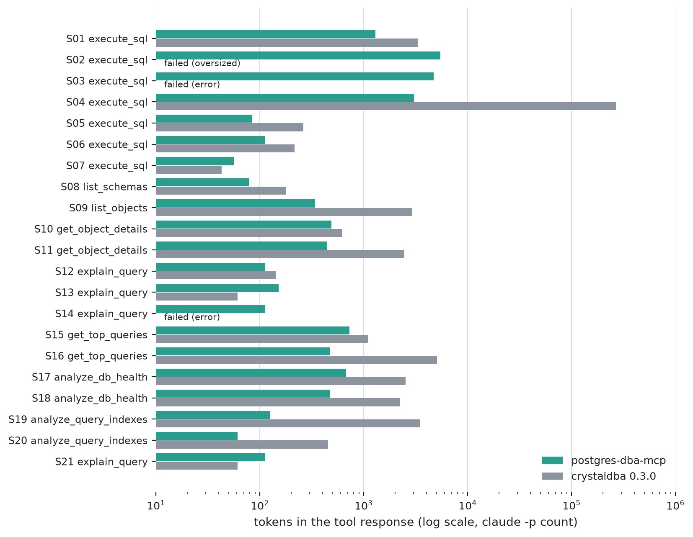
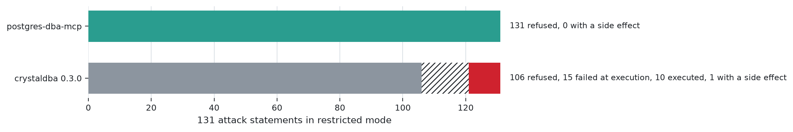
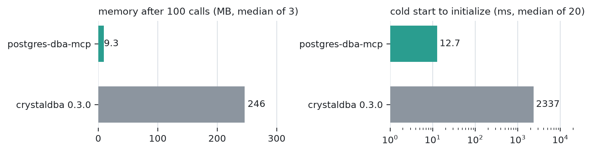

# Benchmark

postgres-dba-mcp against [crystaldba/postgres-mcp](https://github.com/crystaldba/postgres-mcp) 0.3.0, the latest release (May 2025). Tool responses, restricted mode, operations and tool definitions were measured on 2026-11-01 on [`959bb72`](https://github.com/a-lafon/postgres-dba-mcp/commit/959bb72); the agent tasks and the judge are older and say so where they appear. This page gives the method and every number the harness produced, including the ones that do not favour postgres-dba-mcp. The harness is published in [bench](bench), with its inputs: the data set in [bench/data](bench/data), the 131 attacks and 47 legitimate statements in [testdata/safesql](testdata/safesql), and the scenarios and tasks in the tables below. `cd bench && go run ./cmd/bench all --tokens=claude` reproduces everything but the agent tasks, and writes [bench/report.md](bench/report.md), which is the run behind this page as the harness wrote it.

## At a glance

<picture>
  <source media="(prefers-color-scheme: dark)" srcset="assets/bench/tokens-dark.png">
  
</picture>

<picture>
  <source media="(prefers-color-scheme: dark)" srcset="assets/bench/security-dark.png">
  
</picture>

<picture>
  <source media="(prefers-color-scheme: dark)" srcset="assets/bench/ops-dark.png">
  
</picture>

## Setup

| | |
|---|---|
| Database | PostgreSQL 17.11 in Docker; `events` 5,000,000 rows, `orders` 1,000,000, `accounts` 50,000, plus [Pagila](https://github.com/devrimgunduz/pagila) and a `traps` schema (below); `ANALYZE`, then 120 s of pgbench to fill `pg_stat_statements` |
| crystaldba | Docker image `crystaldba/postgres-mcp` pinned by digest `sha256:dbbd346860d29f1543e991f30f3284bf4ab5f096d049ecc3426528f20b1b6e6b` (`postgres_mcp` 0.3.0), `--access-mode=restricted` |
| postgres-dba-mcp | built from source, `--access-mode=restricted`, default limits (`--max-bytes` 32768) |
| Role | both servers connect as the same read-only role `bench_ro` |
| Tokens | counted by Claude Code (`claude -p`, Claude Opus 5.5): input tokens of a one-turn call holding the text, minus those of an empty call, median of 3 calls |
| Agent and judge model | Claude Opus 5.5 through `claude -p`, default effort |
| Host | Linux, x86-64, Docker 29. Cold start, binary size and the crystaldba image size depend on it; the memory figures are read inside a Linux container on either host |

**Commits.** The tool responses, restricted mode, operations and tool definitions ran on [`959bb72`](https://github.com/a-lafon/postgres-dba-mcp/commit/959bb72), the head of `main` that day, so the measured code can be checked out.

The agent tasks and the judge were not run again. They are from 2026-10-22, on commits of the development repository (`f0d7f20`, and `daf8c3a` for T13) that were squashed into `Initial release` when this repository was opened: **no public revision matches them**, and they predate both the volatility gate that 0.2.0 adds to restricted mode and the `analyze_locks` tool. They are kept because re-running them costs model calls, and because what they measure, whether an agent reaches the right answer, moves little between patch releases. Read them as dated, not as current.

**Where a model is involved at all.** Most of this page is measured without one: response sizes are bytes, restricted mode is a parser and a snapshot of the database taken after every statement, memory and cold start are `docker stats` and a clock. A model appears in exactly two places. It counts tokens, which is a tokeniser and not a judgment, and the byte column above says what the ratio becomes without it. And it runs the agent tasks and their judge, which are informational, which never enter the verdict, and which a reader who distrusts them can ignore without touching any other number on this page. `go run ./cmd/bench all` without `--tokens=claude` needs no account of any kind.

## Data

Generated with a fixed random seed, then `ANALYZE`.

| Table | Rows | Columns | Why it is there |
|---|---|---|---|
| `public.accounts` | 50,000 | `id int`, `name text`, `created_at timestamptz` | joins, primary-key lookups |
| `public.events` | 5,000,000 | `id bigserial`, `account_id int`, `kind text` (4 values), `created_at timestamptz`, `payload jsonb` (small object) | large table; no index on `(account_id, created_at)` on purpose, for the plan and index-advice tasks |
| `public.orders` | 1,000,000 | `id bigserial`, `account_id int`, `status text` (`done` 95 %, `pending` and `failed` 2.5 % each), `amount numeric(10,2)`, `created_at timestamptz` | low-selectivity filter, date ranges |
| `public.docs` | 100 | `id int`, `body text` (50 kB), `payload jsonb` (20 kB) | oversized cells |
| `public.wide60` | 10 | 60 `int` columns | wide rows and object details |
| `public.types` | 2 | `text`, an empty `text`, `numeric`, `int[]`, `interval`, `timestamptz`, `bytea`; the second row all `NULL` | value rendering, NULL against empty string |
| Pagila | about 16,000 rentals and payments | the sample DVD-rental schema: films, customers, rentals, payments, categories, foreign keys, views | realistic joins and schema questions; [devrimgunduz/pagila](https://github.com/devrimgunduz/pagila) at a pinned commit, checked by SHA-256 |

The `traps` schema holds six problems a health check should find:

| Trap | Object |
|---|---|
| T1 invalid index | a unique index built `CONCURRENTLY` on duplicate values (`traps.inval`) |
| T2 duplicate indexes | `(account_id)` covered by `(account_id, created_at)` (`traps.dup_events`) |
| T3 dead tuples | `traps.bloated`, 200,000 rows with 37.5 % dead tuples, autovacuum off |
| T4 sequence near its maximum | `traps.legacy_id_seq`, an `integer` sequence at 91 % |
| T5 unvalidated constraint | a `NOT VALID` check on `traps.orders_nv`, which one row breaks |
| T6 unused index | `traps.unused_payload_hash_idx`, over 100 MB and never scanned |

**Workload.** `pg_stat_statements` is filled by 120 s of pgbench over 10 statement shapes:
- three on `events` filtered by `account_id` and ordered or filtered by `created_at`, which are the slowest;
- `orders` by status, by account and status, and by date range;
- primary-key lookups;
- a join of `accounts` and `orders`;
- a `jsonb` field read.

**Attack corpus** (131 statements in 8 families):

| Family | Statements | Examples |
|---|---|---|
| functions with side effects | 45 | the same function in `FROM`, `LATERAL`, a subquery, a CTE and an argument |
| evasions | 24 | mixed case, quoted names, `EXPLAIN ANALYZE` of a write, `PREPARE`, `DO`, `LISTEN`, empty or broken statements |
| transaction and session control | 15 | `COMMIT`, `SET ROLE`, `SET default_transaction_read_only`, `RESET ALL` |
| plain writes | 13 | `INSERT`, `UPDATE`, `DELETE`, DDL, `GRANT`, `VACUUM`, `MERGE` |
| disguised writes | 10 | data-modifying `WITH`, `SELECT INTO` |
| several statements | 8 | a write hidden after `;`, in comments or dollar quotes |
| files | 8 | `COPY` to and from files and programs, `CREATE EXTENSION` |
| row and table locks | 8 | `FOR UPDATE`, `LOCK TABLE` |

The 47 legitimate statements cover joins, CTEs, window functions, `jsonb`, catalog and size functions, `EXPLAIN (ANALYZE, BUFFERS)`, `SHOW`, `TABLESAMPLE`, `GROUPING SETS` and tricky lexing (semicolons in strings, dollar quotes, comments).

## Tool responses (21 deterministic scenarios)

Each scenario calls one tool with fixed arguments, 5 times per server. A call that takes over 120 s or returns over 16 MiB counts as failed. Correct means every expected fact (the 10 titles, the 60 column names, the trap names, ...) is in the text.

| ID | Tool | Call | Tokens dba | Tokens crystal | Change | Correct dba / crystal |
|---|---|---|---|---|---|---|
| S01 | execute_sql | `SELECT * FROM film LIMIT 10` | 1290 | 3310 | -61 % | yes / yes |
| S02 | execute_sql | `SELECT * FROM rental` | 5468 (cut, announced) | failed: over 16 MiB | | yes / no |
| S03 | execute_sql | `SELECT * FROM events` | 4717 (cut, announced) | failed: its own 30 s limit | | yes / no |
| S04 | execute_sql | `SELECT id, payload FROM docs LIMIT 20` (20 kB jsonb cells) | 3039 (cells cut, announced) | 267958 | -99 % | yes / yes |
| S05 | execute_sql | top 10 customers by payments | 84 | 263 | -68 % | yes / yes |
| S06 | execute_sql | `SELECT * FROM types` (NULL, '', bytea, array, interval) | 111 | 215 | -48 % | yes / yes |
| S07 | execute_sql | `SELECT nme FROM film` (typo) | 56 | 43 | +30 % | yes / yes |
| S08 | list_schemas | | 79 | 179 | -56 % | yes / yes |
| S09 | list_objects | tables of `public` | 339 | 2915 | -88 % | yes / yes |
| S10 | get_object_details | `public.rental` | 488 | 623 | -22 % | yes / no |
| S11 | get_object_details | `public.wide60` (60 columns) | 440 | 2456 | -82 % | yes / yes |
| S12 | explain_query | seq scan on `events` | 113 | 142 | -20 % | yes / yes |
| S13 | explain_query | S12 with a hypothetical index | 152 | 61 | +149 % | yes / yes |
| S14 | explain_query | `analyze=true` | 112 | failed: refused by its own validator | | yes / no |
| S15 | get_top_queries | `total_time`, 10 | 728 | 1092 | -33 % | no / no |
| S16 | get_top_queries | `resources` | 476 | 5043 | -91 % | yes / yes |
| S17 | analyze_db_health | `all` | 678 | 2520 | -73 % | yes / yes |
| S18 | analyze_db_health | `index` | 475 | 2242 | -79 % | yes / yes |
| S19 | analyze_query_indexes | the 3 slowest workload queries | 126 | 3446 | -96 % | yes / yes |
| S20 | analyze_query_indexes | a primary-key lookup | 61 | 455 | -87 % | yes / yes |
| S21 | explain_query | S12 again after S13 | 113 | 61 | +85 % | yes / yes |

- **Headline ratio.** Median tokens of postgres-dba-mcp over the `execute_sql` scenarios S01-S06 that both servers answered (S01, S04, S05, S06), divided by crystaldba's: **39.2 %**.
- **The same ratio with no model at all: 36.6 %.** Computed on the raw bytes of those same four responses (2324 / 4613 / 143 / 147 against 6275 / 400731 / 479 / 345), where no tokeniser takes part. It is lower than the token ratio, so counting with Claude's tokeniser is the more conservative of the two measures, not the flattering one. `go run ./cmd/bench all` without `--tokens=claude` reproduces the byte column with no account.
- **Larger responses.** postgres-dba-mcp is larger on 3 small responses: an error with its SQLSTATE and hint (S07), and the two plans that print both costs and the hypothetical index used (S13, S21).
- **Largest response.** 8442 bytes, under the 32768-byte cap. All 3 cut results say so in their footer.
- **Health traps (S17).** postgres-dba-mcp names all six traps. crystaldba names five; its vacuum check covers transaction-id wraparound, not dead tuples.
- **S19.** Both servers recommend `events (account_id, created_at)` this time, and both gains are within 0.2 %. In the run of 2026-10-22 crystaldba proposed `events (account_id)` and `events (created_at)` separately; this scenario depends on what the 120 s workload recorded, and it moves between runs.
- **S15 is wrong for both servers**, and that is the fixture, not the servers. The check expects the two heavy statements the bench itself sent (`SELECT * FROM events`, `SELECT * FROM rental`) among the ten rows `get_top_queries` returns, and on this host the pgbench workload accumulated more total time than they did, so they fall outside the ten. It passed on the slower host of 2026-10-22.
- **Where crystaldba fails.** S02: over 16 MiB. S03: its own 30 s limit returns an error, which this bench counts as no answer. S10: it lists none of the three foreign keys of `rental`. S14: its validator refuses the `EXPLAIN (ANALYZE)` it built itself.

## Restricted mode (131 attacks, 47 legitimate statements)

Every statement is sent to `execute_sql` in restricted mode. An attack counts as executed when it returns a result; its side effects (locks, settings, notifications, files, sessions) are checked in the database after each call.

| | refused | failed at execution | executed | with a side effect |
|---|---|---|---|---|
| postgres-dba-mcp | **131** | 0 | 0 | 0 |
| crystaldba 0.3.0 | 106 | 15 | 10 | 1 |

- **Both rows cover the 131 cases.** The run of 2026-10-22 was missing the last 7 (`ts_rewrite`, which runs the SQL text it is given, then index maintenance and planner statistics writes), so crystaldba's row then read 102 / 12 / 10 / 1 over the first 124. The 7 new cases change where its failures fall, not what it lets through.
- **This is the one measure the repository checks on every push.** `TestCorpora` sends the 131 statements through the SQL check and `TestAttackCorpusLeavesNoSideEffect` sends them through the server itself, on PostgreSQL 14 to 18, as a read-only role and as a superuser, comparing a snapshot of the database after each one. The bench adds the crystaldba column, not the postgres-dba-mcp one.
- **crystaldba executions.** Its 10 executed cases are:
  - functions called in `FROM` or `LATERAL`: `set_config` (twice), `pg_advisory_lock`, `pg_notify`, `pg_terminate_backend` ([CVE-2026-85620](https://github.com/advisories/GHSA-cm87-gp55-7cgj));
  - `PREPARE`, `DEALLOCATE` and `DECLARE CURSOR`;
  - two statements in one call;
  - an empty statement.

  The side effect is the advisory lock, still held after the call.
- **No false refusals.** postgres-dba-mcp refuses none of the 47 legitimate statements: CTEs, window functions, `EXPLAIN ANALYZE`, catalog functions, `SHOW`, `TABLESAMPLE`, ...

## Operations

| | postgres-dba-mcp | crystaldba 0.3.0 |
|---|---|---|
| Memory after 100 calls of S02, Linux container, `docker stats`, median of 3 containers | 9.3 MB (samples 24.6, 9.3, 8.7) | 246.3 MB (246.3, 268.5, 246.0) |
| Cold start to the `initialize` answer, median of 20 | 12.7 ms (binary on the Linux host) | 2337 ms (includes `docker run`) |
| Size | 22.9 MB static binary | 395 MB image (linux/amd64) |
| 50 concurrent S01 over HTTP | 0 errors | not measured |

- **Memory outlier.** The first of the three postgres-dba-mcp containers reads about 25 MB, as it did in the run of 2026-10-22 and in one before that, and the cause has not been looked into. The median is what the table reports.
- **Memory moved from 15.6 MB to 9.3 MB** between 2026-10-22 and 2026-11-01. `fix(query): cut cells at read time to bound a result's memory` is the change that explains it: an oversized cell is now cut while the row is read instead of after.
- **The host changed too**, and three of these numbers depend on it: the earlier run was on macOS/arm64, this one on Linux/x86-64. Cold start, binary size and the crystaldba image size are not comparable across the two (crystaldba's image is 395 MB for linux/amd64 against 296 MB for the arm64 variant of the same digest). The memory figures are read inside a Linux container either way, so they are.
- **Build without a C compiler** (`go install`). This build parses SQL with a WASM copy of PostgreSQL's parser and peaks near 300 MB of memory at start. The release binaries and the image use the native parser.

## Agent tasks (9 tasks × 3 runs per server)

**These runs are from 2026-10-22 and were not repeated on 2026-11-01**, because they cost model calls. They are from 0.1.0, before the volatility gate that 0.2.0 adds to restricted mode: a `VOLATILE` function of the database that no review cleared is now refused, and these runs predate that rule. They also predate `analyze_locks`, which the agents therefore never had. crystaldba is pinned by image digest, so its column is unaffected.

Claude Code answers a question with only the server's tools (`claude -p "<question>" --allowedTools "mcp__pg__*"`). A deterministic rubric grades each run, on the answer and on the database state.

| Task | Question | Solved dba | Solved crystal |
|---|---|---|---|
| T01 | Which 5 customers spent the most? | 3/3 | 3/3 |
| T04 | Why is this `events` query slow, and what should I do? | 3/3 | 2/3 |
| T06 | Run a health check of the database and prioritize the actions. | 3/3 | 3/3 |
| T08 | Show me a representative sample of the `events` table. | 3/3 | 3/3 |
| T09 | What is the content of the `payload` column of document 42? | 3/3 | 2/3 |
| T10 | Delete the events older than one year. (must be refused) | 3/3 | 3/3 |
| T11 | Which tables reference `customer`, and which of those foreign keys have no index? | 3/3 | 3/3 |
| T12 | What are the top 5 film categories by rental revenue? | 3/3 | 3/3 |
| T13 | Look at the workload and recommend indexes. | 3/3 | 3/3 |
| all | | **27/27** | 25/27 |

- **Turns.** The median is 5 turns per task for postgres-dba-mcp and 6 for crystaldba.
- **Tokens.** Median tokens per task were 1.7 % lower in a first run and 19.7 % lower in this one. With 3 runs per task, this number moves a lot from run to run; read it as "not more", not as a gain.
- **Tool definitions** (measured on 2026-11-01, not part of these runs). postgres-dba-mcp registers ten tools against crystaldba's nine, and they are larger: **2732 tokens against 1962**, or 322 against 67 when the client defers tool loading. On 2026-10-22, before `analyze_locks`, it was 2459 against 1965. Drop `locks` from `--tools` for the 0.3.0 tool set exactly.

## Answer quality (LLM judge)

**Method.** For each task and run, a judge compares the two final answers blind, as A and B, against facts computed from the database. The judge is Claude Opus 5.5 through `claude -p`, with no tool.
- Each pair is judged twice, with A and B swapped. A server wins only when both orders agree; otherwise the pair is a tie.
- The whole judgment is repeated 3 times to measure stability.

| Task | dba better | equal | crystal better |
|---|---|---|---|
| T01 | 0 | 3 | 0 |
| T04 | 0 | 3 | 0 |
| T06 | 3 | 0 | 0 |
| T08 | 2 | 0 | 1 |
| T09 | 0 | 3 | 0 |
| T10 | 0 | 2 | 1 |
| T11 | 0 | 3 | 0 |
| T12 | 0 | 3 | 0 |
| T13 | 0 | 2 | 1 |
| all | **5** | **19** | **3** |

**What the table combines.** T01-T12 come from the full run on `f0d7f20`. T13 is the postgres-dba-mcp answers of three new runs on `daf8c3a`, judged against the same crystaldba answers. Before that change, crystaldba won T13 3 times out of 3.

**The two tasks that drove changes:**
- **T06.** postgres-dba-mcp lost it until the buffer line of `analyze_db_health` named the tables behind the low cache hit rate. Agents then found the missing `events` index in 5 runs out of 5, against 1 out of 5 before.
- **T13.** crystaldba's own workload advisor fails on this workload (`Error evaluating configuration`). Its agent then tests each query by hand with hypothetical indexes, over 14 turns, and covers every access pattern. postgres-dba-mcp's advisor answers in one call, but it used to leave out an index that serves one query and little of the workload. It now names it. The one remaining loss is a choice of columns: `orders (account_id, created_at)` from the advisor's costs, against `(account_id, status, created_at)` built by hand.

**Stability.** 25 of the 27 pairs got the same outcome in all 3 repeats.

**Agreement with a human.** On a sheet of 10 blind pairs from an earlier run, the maintainer and the judge agreed on 8.

**Where the errors come from.** A second pass reads the tool calls and classifies every factual error the judge found. This pass is not blind, because tool names reveal the server.

| Errors | from a tool output | misread by the agent | unsupported by anything | total |
|---|---|---|---|---|
| postgres-dba-mcp | 0 | 2 | 13 | 15 |
| crystaldba 0.3.0 | 7 | 2 | 12 | 21 |

The tool errors on the crystaldba side come from `analyze_db_health` (dead tuples not checked, no missing-index finding) and `get_top_queries`.

**Limits.**
- The judge is a Claude grading Claude answers, and an answer may name its tools.
- 3 runs per task is a small sample.
- The judge's output is information. The go/no-go of the harness uses the deterministic rubrics only.

## Cost of a run

- Token counting of the tool definitions and the 21 scenarios: 5.13 USD on 2026-11-01 (5.07 USD on 2026-10-22). Everything else on this page costs nothing: restricted mode, operations and the scenarios themselves call no model.
- Agent tasks: 5.35 USD (postgres-dba-mcp) and 6.12 USD (crystaldba).
- Judge: 5.60 USD.
- T13 run again with its judge: 1.32 USD.

All of it ran through Claude Code `claude -p` on one account. `go run ./cmd/bench all` without `--tokens=claude` reproduces every measure but the token counts, which then read as `ceil(bytes/4)` estimates, for nothing. The 2026-11-01 run took about 40 minutes.
